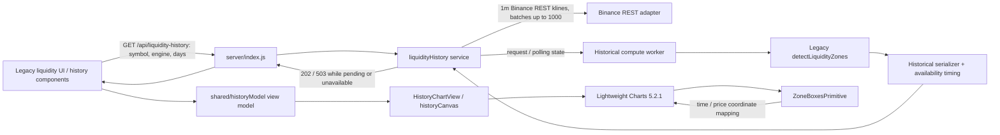
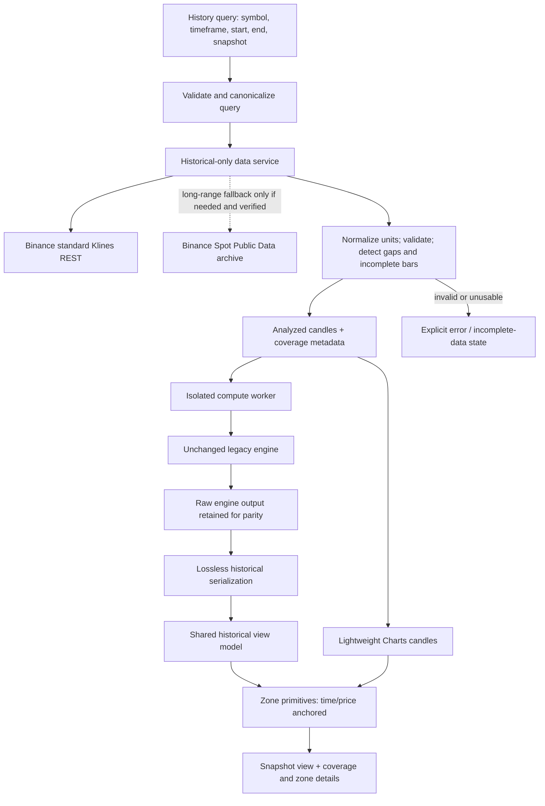

# هندسة الشارت التاريخي لمناطق السيولة

**الحالة:** توثيق baseline والتصميم المستهدف قبل تعديل التطبيق.
**الحدود:** التنفيذ التاريخي الجديد منفصل عن المحرك الحي؛ لا يُسمح بتعديل `detectLiquidityZones` أو `adaptiveConfig` أو قواعد الكشف أو استدعاءات الإنتاج الحي ضمن هذه المهمة.

## الخريطة المعمارية الحالية

### Observed behavior and gaps

- The API currently provides a depth-in-days query around 1-minute candles, not an arbitrary interval and explicit historical start/end/snapshot contract. The existing service fetches Binance pages capped at 1,000 candles, computes its depth from the current server time, and has no user-selected historical cutoff.
- In the existing history fetch path, timestamps are sorted/deduplicated by dropping rows whose open time is not later than the last accepted row; this is not reported as duplicate/out-of-order data. OHLCV sanity and expected interval boundaries are not validated there. `gaps` is currently `expectedBars - bars`, which cannot identify exact gap positions and can also reflect filtering or endpoint boundaries. The current candle may be unfinished.
- The manual-drawing candle endpoint is a separate path. It validates positive OHLC values and range consistency, sorts/deduplicates rows, counts invalid/duplicate rows and gaps, and marks completeness; however, it clamps to the latest 90 days, fetches at most one 1,000-row page, and its cache is not a historical snapshot contract. It is evidence of useful validation patterns, not a reusable historical-range service.
- `candleStore.mjs` is an in-memory live stream aggregation store with a default per-key capacity of 400 and does not fetch arbitrary history. It must not be treated as a historical source or changed as part of this task.
- Binance REST Klines accept interval and start/end millisecond timestamps with a maximum limit of 1,000. The service already uses standard `/api/v3/klines`; keep it separate from `uiKlines`. Official archive Klines support daily/monthly files and checksums, but Spot timestamps from 2025-01-01 onward are microseconds and need explicit source-aware conversion.
- The history cache key is currently `symbol|engine|days`; it omits timeframe, dates, snapshot, data provenance and serializer version because those are not inputs today. The server worker calls the legacy detector and the serializer adds availability timing. A distinct immutable raw-engine-output record for parity comparisons is not currently established.
- Historical chart components and `shared/historyModel.mjs` exist, but the legacy screen does not currently mount those history components. Live/history zone-list functions remain the mounted surface; chart integration is a separate route/component decision.
- Lightweight Charts primitives already map chart-domain time and price to coordinates. Existing pure tests cover parts of coordinate/layout behavior; no browser-level proof of placement, zoom, drag, or resize is established yet.
- `adaptiveConfig` depends on the supplied end index. One full-range computation filtered later by event time is therefore not evidence of a historically valid Replay.
- Legacy `availableAt` is derived from actual candles using `rightBars` in `liquidityHistorySerialize.mjs`; this is a useful knowledge-time contract, but it does not by itself correct a computation whose input includes bars after the selected snapshot. Warm-up range and full serialized model parity remain to be established with fixtures.

## Target Snapshot data flow

The first dependable mode is **Historical Snapshot**. User-selected symbol, timeframe, start, end, and snapshot time are validated as one query; the controller cancels or supersedes older requests. A historical-only service obtains standard market Klines, normalizes and validates them, records gaps and completeness, and supplies any required pre-range warm-up separately from the user-visible range. A worker runs the unchanged legacy detector only on permitted candles. It preserves the raw engine result, serializes without dropping engine fields, and makes a shared view model for the chart. Lightweight Charts receives the same analyzed candle set; primitives draw from the preserved zone data using public time/price mappings.

This is a target contract, not a statement that those stages already exist. The Binance archive is optional for integration and cannot replace checksum, timestamp, and source comparison tests. `uiKlines` is not the analysis default.

## Data ownership and contracts

### 1. Historical query

The eventual request contract is explicitly scoped to the historical path and includes `symbol`, `timeframe`, `startTime`, `endTime`, and `snapshotTime` (UTC epoch units to be finalized with the existing API). Validation must reject unsupported symbols/intervals, non-finite or reversed bounds, a snapshot outside the permitted range, and requests exceeding documented service limits. Engine selection must not expose V2 or merge V2 results into legacy output.

The output must expose query identity and completeness so the UI can distinguish loading, complete, incomplete, empty, and failed results. New fields and exact wire names must be confirmed against current shared types before implementation.

### 2. Candle set

- The calculation and displayed candlesticks must be the same normalized input set; any warm-up prefix is separately identified and not misrepresented as requested display time.
- Validate numeric OHLCV values, OHLC bounds, monotonic unique timestamps, expected interval spacing, missing intervals, and whether the final bar is complete. Do not synthesize replacement bars silently.
- Keep UTC instants canonical internally. Handle REST milliseconds and archive Spot microseconds with source-specific conversion; do not guess a unit from an untrusted magnitude alone.
- A snapshot excludes any candle whose information was unavailable at the snapshot. The exact final-bar boundary must account for interval close time and completeness.

### 3. Engine and historical zone

- Call the existing legacy detector via its real signature and current configuration. No detection calculations are duplicated in the UI.
- Retain a raw output for each calculation before serialization. The serialized zone/view model must preserve the actual engine fields and values, including exact zone type, direction, prices/line points, timestamps, touches, state, and IDs when those fields exist in the real output. This list is an audit checklist, not a mandate to invent fields.
- Treat event times distinctly. `createdAt`, `confirmedAt`, `availableAt`, `sweptAt`, and `invalidatedAt` must be mapped only after confirming their real definitions. A pivot's occurrence time is not automatically its knowledge/availability time.
- Use stable IDs from the engine if present; otherwise the identity design must be deterministic and tested. Do not change identity across view-range or screen-size changes.

### 4. Cache and request lifetime

A historical cache key must include every input capable of changing computation: symbol, interval, requested bounds, warm-up/data coverage, snapshot time, engine version, data source/version and serialization version, plus relevant configuration identity. Cache values must not cross symbol/interval/range boundaries. Older or cancelled responses must not overwrite the newest query. Current cache and cancellation behavior require code-level verification before selecting an implementation.

## Failure boundaries

| Failure boundary | Required behavior |
|---|---|
| Invalid query / unreasonable range | Reject with a precise validation response before market-data work; apply bounded request policy. |
| Binance unavailable / rate-limited | Preserve a diagnosable failure; retry only under bounded policy; never represent it as a valid empty zone result. |
| Archive corrupt or checksum mismatch | Do not ingest; retain source and checksum context; fall back only if an explicitly validated path is available. |
| Missing, duplicated, malformed, or incomplete candles | Surface coverage/quality state; do not silently deduplicate or fill synthetic values that change the engine input. |
| Worker error, timeout, or termination | Fail the calculation explicitly, discard partial output, and permit a bounded retry/cancel. |
| Request superseded | Ignore/cancel stale result by a request identity; do not render it over the latest symbol/range. |
| Primitive/chart lifecycle error | Detach listeners and primitives cleanly, surface a visible chart state, and avoid leaking chart instances. |
| Empty but successful calculation | Distinguish “no zones found” from “no candles”, “data incomplete”, and service failure. |

## Separation from live production paths

- Do not modify the legacy detection algorithm or its parameters, `findPivots`, `stateFor`, or decision rules.
- Keep new interval/range/snapshot query handling under an explicit history-only route/service/worker contract. Do not alter Live Scanner, Live Opportunities, Strategy 2, Lifecycle, Tracker, notifications, or their database/cache semantics.
- Do not delete current chart, drawing, worker, or service components solely because they appear unused; verify all imports/routes and tests before any retirement. Manual drawing and V2 are separate surfaces.
- A snapshot must be reproducible from its query and normalized input provenance. Do not claim Replay: it remains disabled unless prefix-by-prefix calculation matches the reference engine and meets measured performance requirements.

## Evidence required before marking the design implemented

1. A query-to-candles provenance record demonstrates symbol, timeframe, UTC bounds, source, completeness, warm-up, and snapshot cutoff.
2. Golden tests show unchanged legacy raw output across worker and serializer boundaries.
3. Tests show no future candles/zones leak into a snapshot, and lifecycle fields appear only when known at the chosen snapshot.
4. Independent tests verify price/time anchors and zone geometry across visible-range changes, zoom, pan, resize, and device-pixel ratio.
5. Browser tests run with Playwright, monitor console/network failures, and compare stable reference states. Screenshots alone do not prove engine or coordinate correctness.
6. Performance measurements report candle count, zone count, timings, and memory; no silent truncation is acceptable.

**Current status at baseline:** this map was reviewed before implementation. Outstanding validation is listed in the implementation-status section below; candle/source correctness, Replay, and live-data end-to-end validation remain **NOT VERIFIED**.

## التنفيذ والتحقق الحاليان — 2026-11-10

- أضيف مسار Snapshot مستقل في `server/index.js` و`server/services/liquidityHistorySnapshot.mjs`؛ يستعمل Binance REST Klines القياسية عن طريق محول قاعدة البيانات الحالي، ولا يغيّر خدمة التاريخ القديمة أو مخزن الشموع الحية.
- تُتحقق معلمات الرمز والفريم والنطاق واللقطة، ويُجلب التاريخ بصفحات لا تتجاوز 1000 شمعة. يحدّ النظام الطلب إلى 129,600 شمعة، ويستخدم Worker بحد ذاكرة/مهلة، ويمنع تجاوز سعة قائمة المهام. هذه سقوف تشغيلية معلنة وليست سقفًا صامتًا.
- `normalizeHistoryKlines` يتحقق من OHLCV، الترتيب والتكرار، ويستبعد الشموع التي لم تغلق عند زمن اللقطة. يسجل الفجوات الداخلية ولا ينشئ شموعًا صناعية. المصدر الحالي REST بالمللي ثانية فقط؛ دعم Binance Archive وميكروثانية 2025 وما بعدها **NOT VERIFIED وغير مدمج**.
- العامل يمرر الشموع نفسها للمحرك القديم دون تعديل `engine.mjs` أو `adaptiveConfig`. يحتفظ الناتج الخام داخليًا لاختبار parity، ويسلسل الحقول الزمنية/التاريخية. API لا يرسل `rawZones` للعميل؛ واجهة تفاصيل المنطقة تعرض الحقول المرسلة في نموذجها.
- مفتاح الكاش يميز الرمز والفريم وحدود الفترة وزمن اللقطة وإصدارات البيانات والمحرك والمسلسل. النتائج المتطابقة تشترك بعملية واحدة، وتُعرض أخطاء الخدمة صراحةً بدل استبدالها بنتيجة فارغة.
- أضيفت شاشة Snapshot في واجهة مناطق السيولة القديمة، وتستخدم `HistoryChartView` وLightweight Charts الحالية. تتلقى الشموع المرسومة نفس مجموعة الشموع الداخلة للحساب؛ وPrimitive تُحوّل الوقت والسعر عبر واجهات المكتبة القائمة.
- Warm-up مضبوط حاليًا على صفر (`warmupBars: 0`) لعدم توفر دليل parity على مدى تمهيدي آخر. هذا قرار محافظ وموثق، لكنه لا يثبت أن كل إعدادات المحرك مستقلة عن السياق السابق.
- اختبارات المحرك: fixture مرجعي ثابت يقارن بصمة مخرجات `detectLiquidityZones` مع خرج العامل الخام بعد استبعاد حقل وقت التنفيذ المتغير؛ واختبارات خدمة البيانات والتسلسل والتخزين المؤقت، مع fast-check ببذور ثابتة. لا يثبت ذلك اكتمال السوق الفعلي.
- **PASS:** 796 اختبار خادم، 60 اختبار عميل، TypeScript/build للعميل، واختبار TypeScript منفصل لملفي Playwright.
- **PASS:** Playwright Chromium E2E على API fixture: يفتح Snapshot، يتحقق من الرمز والفريم والنطاق في الطلب، يرسم الشموع والمنطقة، يختار المنطقة ويقرأ تفاصيلها، ثم يغير حجم النافذة ويقارن لقطة Canvas بمرجع Linux مثبت.
- **PASS:** تحقق حيّ من خلال واجهة المعاينة وBinance REST: طلب BTCUSDT/1h لأربعة أيام تقويمية عاد 202 مع حالة الحساب ثم 200، و111 شمعة و3 مناطق وفجوات صفرية؛ لم تظهر أخطاء JavaScript.
- التشغيل المحلي بلا إعدادات `SUPABASE_URL`/المفتاح العام؛ مؤشرات وأجزاء قائمة على التخزين تظهر أخطاء/بيانات قديمة، بينما مسار Snapshot التاريخي الذي اختُبر نجح. لم تُضف أسرار أو إعدادات تخزين.
- **NOT VERIFIED:** شمولية تغطية Binance عبر فترات متعددة والتحقق المستقل من صحة ملفات السوق، تطابق شامل لكل الحقول على نطاقات تاريخية فعلية، Warm-up غير الصفري، تطابق الهندسة عبر pan/zoom/fullscreen وكل أحجام الشاشة في المتصفح، Firefox/WebKit، checksum للأرشيف. Replay غير مطبق: على fixture اصطناعي، بادئتا 200 و300 شمعة أعادتا منطقتين بينما فلترة الناتج الكامل حسب `availableAt` أعادت منطقة واحدة؛ لذلك لا يُعرض Replay.
- قياس سابق على بيانات اصطناعية فقط: المحرك نحو 0.8s لـ25,000 شمعة، 2.4s لـ60,000، و5.2s لـ129,600. هذه القياسات لا تمثل ضمان أداء حي؛ يلزم قياس خدمة الجلب والرسم والذاكرة على ظروف واقعية قبل أي توسيع للحد.
